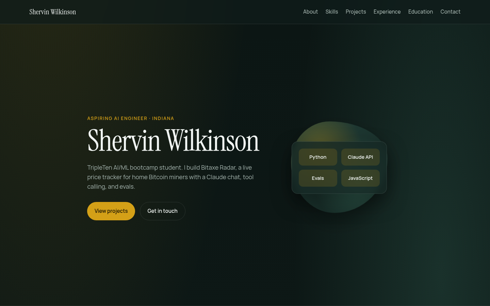

# Shervin Wilkinson — Portfolio

Personal portfolio site of Shervin Wilkinson, an aspiring AI engineer in Indiana and a student in TripleTen's AI/ML bootcamp.

**Live site:** [yostoo.github.io/my-portfolio](https://yostoo.github.io/my-portfolio/)



## What's on the site

- **About, skills, experience, and education.** Current AI and engineering skills, plus work history, CompTIA certifications, and TripleTen training.
- **[Bitaxe Radar](https://bitaxeradar.com).** Featured project. A live price tracker for home Bitcoin miners, with a Claude chat that uses tool calling and a 32-case eval set. Code: [YoStoo/bitaxe-radar](https://github.com/YoStoo/bitaxe-radar).
- **[Titanic Survival API](https://github.com/YoStoo/titanic-survival-api).** A Random Forest model (81.6% accuracy) served with FastAPI, shipped as a Docker image on [Docker Hub](https://hub.docker.com/r/stoo14/titanic-survival-api), with Kubernetes manifests, automated tests, and CI.
- **This portfolio site.** Built in July 2026 with Cursor, as a TripleTen project to learn AI coding agents.
- **Earlier TripleTen data projects.** A prepaid-plan revenue analysis (Megaline) and an Instacart shopping-habits EDA.

## Tech stack

- HTML and CSS (no framework)
- [Instrument Serif](https://fonts.google.com/specimen/Instrument+Serif) and [Manrope](https://fonts.google.com/specimen/Manrope) from Google Fonts
- Hosted on [GitHub Pages](https://yostoo.github.io/my-portfolio/)

## How it was built

I built this site in July 2026 with [Cursor](https://cursor.com), as a TripleTen project to practice directing an AI coding agent. The design — layout, colors, type, and motion — is from that first build. Later updates keep that design and refresh the content so it matches my current work, including Bitaxe Radar.

## Run locally

```bash
git clone https://github.com/YoStoo/my-portfolio.git
cd my-portfolio
python3 -m http.server 8080
```

Then open [http://localhost:8080](http://localhost:8080).
